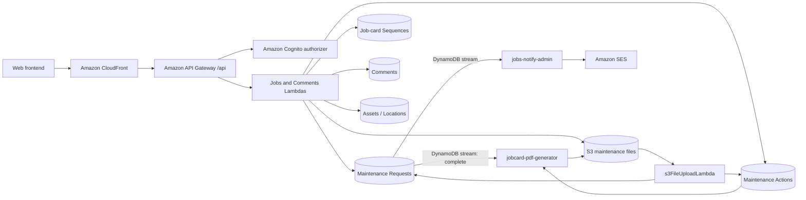

## Jobs Module

### Overview

The Jobs module manages the maintenance-job lifecycle from request capture through approval, assignment, work recording, completion, and downloadable job-card generation. It stores the maintenance request and the technician or contractor's maintenance action separately, links them when work is submitted, and supports request/action images, invoices, comments, and a new-request email notification.

### Problem

Maintenance requests previously depended on informal, manual tracking such as WhatsApp conversations. That made it difficult to establish who requested or owned a job, whether work had been approved or completed, what it cost, and which maintenance history belonged to an asset or store.

The module provides a central record for:

- Requests, priorities, operational impact, and affected assets
- Approval, assignment, target dates, and accountability
- Work performed, findings, root cause, signatures, travel, parts, sundries, contractor costs, and invoices
- Current job status and completion time
- Comments and supporting photographs
- Consistently numbered PDF job cards

### Solution

The implemented workflow is:

```text
Authenticated user submits a request
        |
        v
pending
        |
        +---- approval + assignment ----> in progress
        |                                     |
        |                                     v
        |                            maintenance action recorded
        |                                     |
        |                                     v
        |                                  complete
        |                                     |
        |                                     v
        |                          PDF job card generated in S3
        |
        +---- exact status "Rejected" ----> request and legacy images deleted
```

#### Job Creation

`postJobRequest` validates the request and its non-empty `assets` array, verifies the normalized location against the locations table when that lookup is available, derives the requestor identity from Cognito claims, and creates a UUID-keyed request with status `pending`. Each asset must have an area and equipment value, and must provide either an `assetID` or a supported missing-barcode reason. An unidentified asset must include at least one image.

For each requested image the Lambda returns a one-hour presigned upload URL under `maintenance/{requestId}/assets/{assetIndex}/images/{filename}`. An S3-triggered Lambda later appends the uploaded object's bucket/key metadata to the matching nested asset.

#### Approval and Assignment

`postApproveRequest` requires a target date and assignee name, Cognito `sub`, and group. When its input status normalizes to `approved`, it stores the database status as `in progress`, records the approving user's name and `sub`, assigns the work, and creates a job-card number. A conditional write prevents a second approval from assigning another number.

#### Rejection

`postRejectRequest` has two current behaviours. With the exact case-sensitive status `Rejected`, it deletes the maintenance-request item and the legacy top-level images referenced by that item, returning rejection metadata only in the response. Any other supplied status is written to the request with `reject_message`. Rejected requests therefore are not retained when the frontend sends the expected `Rejected` value.

#### Maintenance Action and Completion

`postJobAction` records the authenticated actioning user's `sub` and name plus start/end time, distance travelled, work completed, root cause, findings, signature, signatory, parts, sundries, contractor details, and their costs. It can issue presigned uploads for action images and invoices.

The Lambda uses a DynamoDB transaction to create the maintenance-action record and update the request with the action's status, `action_id`, and `statusUpdatedAt`. The normal completion value is lowercase `complete`; that value also adds `completed_at` and triggers job-card generation through the maintenance-request stream.

#### Job Card Generation

On a request transition to `complete`, the container-image `jobcard-pdf-generator` Lambda reads the linked maintenance action, merges it with the request, renders a PDF, and writes `jobcards/{requestId}.pdf` to `crud-nosql-app-images`. Existing PDFs are not regenerated. `getJobcardById` accepts the action ID, resolves the request through `ActionIdIndex`, confirms that the PDF exists, and returns a ten-minute presigned download URL.

### User Experience

#### Requestors

Any authenticated user can submit a maintenance request, select a location/area/equipment/asset through the asset-options endpoint, describe the problem and impact, and upload supporting images. In list views, users outside the `admin` and `maintenance` Cognito groups see only requests whose `request_sub` matches their token `sub`.

#### Admin and Maintenance Users

Members of the `admin` or `maintenance` groups can list all maintenance requests and filter them by the exact stored status. Approval captures the target date and an assignee, moves the request to `in progress`, and assigns the job-card number. The current approval and rejection Lambdas do not themselves test the caller's group; their API routes require a valid Cognito token, while any finer restriction must currently be supplied by the frontend.

#### Technicians and Contractors

An assignee can be recorded using `assign_to_name`, `assign_to_sub`, and `assign_to_group`. The maintenance-action form captures the completed work, findings, costs, signature, images, and invoices. For the completed-jobs list, an `admin` sees every action; every other authenticated caller sees only actions whose `action_sub` matches their own `sub`. The handler does not validate the assignee fields before accepting an action, so assignment and actioning user can differ.

#### Viewing Jobs, Job Cards, and Comments

Requests can be filtered by status, while completed actions have a separate list. The detail endpoint reads either a request ID (`pending`, `in progress`, or `rejected`) or an action ID (`complete`) and adds short-lived download URLs to stored files. It currently performs no ownership or group filtering beyond the API Gateway Cognito authorizer.

Authenticated users can post a comment against `request_id` and retrieve that request's comments newest first. The general comments-list endpoint currently scans and returns all comments. The job-card endpoint similarly requires authentication but does not add a role or ownership check.

### Scope

#### Included

- Multi-asset maintenance requests and missing/damaged-barcode capture
- Status filtering, request detail, update, and deletion endpoints
- Approval, technician/contractor assignment, target dates, and rejection
- Maintenance actions, completion data, signatures, and maintenance costs
- Per-location/per-month sequential job-card numbering
- Request images, action images, invoices, and presigned S3 access
- PDF job-card generation and download
- Request-linked comments
- DynamoDB-stream email processing for maintenance requests

#### Excluded

- General asset CRUD, verification, and asset-master ownership
- Asset transfers and disposals, except that those modules may read shared asset data
- Procurement, stock control, payment processing, and physical maintenance work
- Transfer/disposal event buses, queues, reminders, and notification records; they are not part of the Jobs workflow

### Architecture

#### Request Flow

The web client is delivered through CloudFront. Requests under `/api/*` are routed to API Gateway, where every non-`OPTIONS` Jobs, job-card, asset-options, and comments route uses the Cognito user-pool authorizer. API Gateway invokes the mapped Python Lambda, which reads or writes DynamoDB and, where applicable, creates S3 presigned URLs.



The Cognito authorizer is evaluated by API Gateway before the integration Lambda. Cognito is therefore shown as an authorization dependency rather than a service that receives the business request in sequence.

#### Job Lifecycle

| Current status | Written by                                              | Meaning / next action                                                             |
| -------------- | ------------------------------------------------------- | --------------------------------------------------------------------------------- |
| `pending`      | `postJobRequest`                                        | Awaiting review and assignment                                                    |
| `in progress`  | `postApproveRequest` for input `approved`               | Approved, assigned, target-dated, and given a job-card number                     |
| `complete`     | Normally `postJobAction`                                | Action linked to the request; `completed_at` set and PDF stream processing starts |
| `rejected`     | Supported by read handlers and arbitrary status updates | Readable as a status only when retained in the table                              |
| deleted        | `postRejectRequest` for exact input `Rejected`          | Expected rejection path removes the request rather than storing `rejected`        |

`postApproveRequest` and `postJobAction` do not enforce a finite transition table for every input status. The sequence above describes the values generated by the normal workflow, not a general state-machine guarantee.

#### Authentication and Authorization

- API Gateway applies `COGNITO_USER_POOLS` authorization to every documented non-preflight route.
- Request creation uses `sub`, `name`, `family_name`, and `email`; approval uses `sub`, `name`, and `family_name`; maintenance actions use `sub`, `name`, and `family_name`; comments use `sub`, `name`, and `family_name`.
- Request-list access parses `cognito:groups`: `admin` and `maintenance` receive all rows, while other groups are filtered to their own `request_sub`.
- Completed-action access gives `admin` all rows and filters every other caller to their own `action_sub`.
- The detail, create, approve, reject, action, update, delete, comments, asset-options, and job-card handlers rely on authentication but do not currently enforce group, location, ownership, or assignee restrictions inside the Lambda.

#### Job Data Model

The maintenance request is the lifecycle record. Important fields are:

```text
id + jobCreated          composite primary key
status                   pending | in progress | complete (normal flow)
request_sub              Cognito sub of requestor
requested_by             normalized requestor name
user_email, user_name    requestor details from claims
location, type, priority, breakdown_time, impact, description
assets[]                 assetIndex, area, equipment, optional assetID,
                         assetIssueReason/details, images[]
targetDate               assigned completion target
assign_to_name/sub/group assignment metadata
approved_at/by/by_sub     approval audit fields
jobcardNumber            generated during approval
action_id                maintenance action linked at action submission
statusUpdatedAt          last workflow update timestamp
```

The action is a separate record keyed by `id + actionCreated`. It references the request through `request_id` and stores `action_sub`, `actioned_by`, work times, `completed_at`, `status`, root cause, findings, work completed, distance, costs, parts, sundries, contractor data, signature/signatory, images, and invoices. The request's `action_id` provides the reverse link used by job-card retrieval.

```text
Maintenance Request.id <----- Maintenance Action.request_id
Maintenance Request.action_id -----> Maintenance Action.id
```

#### Job-card Numbering

Approval resolves the normalized request location to an uppercase code from the locations table. It atomically increments `lastSequence` in the sequence item `JOBCARD#{LOCATION_CODE}#{YYYYMM}` and formats the result as:

```text
Job-<LOCATION_CODE>-<YYYYMM>-<four-digit sequence>
```

For example, the first October 2026 request for location code `VTR` is `Job-VTR-202610-0001`. Keeping a separate monthly/location sequence item provides an atomic counter even when approvals occur concurrently.

### Infrastructure

#### API Gateway

All routes below are rooted at the CloudFront/API Gateway `/api` path. `OPTIONS` methods are unauthenticated CORS preflight routes and are omitted from the table.

| Method | Route                            | Lambda                       | Authentication | Purpose                                                          |
| ------ | -------------------------------- | ---------------------------- | -------------- | ---------------------------------------------------------------- |
| GET    | `/api/jobs/requests`             | `getJobsList`                | Cognito        | List requests; optional exact `status` query filter              |
| POST   | `/api/jobs/requests`             | `postJobRequest`             | Cognito        | Create a pending multi-asset maintenance request and upload URLs |
| GET    | `/api/jobs/completed`            | `getJobsCompletedList`       | Cognito        | List maintenance-action records with admin/user filtering        |
| GET    | `/api/jobs/{id}?status={status}` | `getJobById`                 | Cognito        | Read request detail or merged completed request/action detail    |
| PUT    | `/api/jobs/{id}`                 | `updateJobById`              | Cognito        | Update a whitelist of request fields; see Open Questions         |
| DELETE | `/api/jobs/{id}`                 | `deleteJobById`              | Cognito        | Delete a request and referenced legacy top-level images          |
| POST   | `/api/jobs/{id}/approve`         | `postApproveRequest`         | Cognito        | Approve, assign, target-date, and number a request               |
| POST   | `/api/jobs/{id}/reject`          | `postRejectRequest`          | Cognito        | Reject/delete a request or write a supplied alternative status   |
| POST   | `/api/jobs/{id}/action`          | `postJobAction`              | Cognito        | Create an action and atomically link/update the request          |
| GET    | `/api/jobs/{id}/jobcard`         | `getJobcardById`             | Cognito        | Treat `{id}` as an action ID and return a PDF download URL       |
| GET    | `/api/assets/options`            | `getJobsRequestAssetOptions` | Cognito        | Supply location/area/equipment/asset choices for job creation    |
| GET    | `/api/comments`                  | `getCommentsList`            | Cognito        | Return the current global comments scan                          |
| POST   | `/api/comments`                  | `postComment`                | Cognito        | Add a comment linked to `request_id`                             |
| GET    | `/api/comments/{id}`             | `getCommentById`             | Cognito        | Return one request's comments, newest first                      |

#### Lambda Functions

| Lambda                                             | Purpose                                                                   | Main resources                 |
| -------------------------------------------------- | ------------------------------------------------------------------------- | ------------------------------ |
| `postJobRequest`                                   | Validate and create a pending request; presign request images             | Requests, locations, S3        |
| `getJobsList`                                      | List/filter request records with Cognito group/owner filtering            | Requests / `StatusIndex`       |
| `getJobById`                                       | Read request detail or merge completed request/action data                | Requests, actions, S3          |
| `getJobsCompletedList`                             | List action records with admin/action-owner filtering                     | Actions                        |
| `postApproveRequest`                               | Assign and approve work; generate the sequential job-card number          | Requests, locations, sequences |
| `postRejectRequest`                                | Delete an exactly rejected request or update another supplied status      | Requests, S3                   |
| `postJobAction`                                    | Create an action and update its request in one transaction; presign files | Requests, actions, S3          |
| `updateJobById`                                    | Update whitelisted request fields                                         | Requests                       |
| `deleteJobById`                                    | Delete a request and legacy top-level images                              | Requests, S3                   |
| `getJobcardById`                                   | Resolve action-to-request and presign the generated PDF                   | Requests / `ActionIdIndex`, S3 |
| `getJobsRequestAssetOptions`                       | Build the job form's location/area/equipment/asset hierarchy              | Assets / `LocationIndex`       |
| `postComment`, `getCommentById`, `getCommentsList` | Create and retrieve request-linked comments                               | Comments                       |
| `s3FileUploadLambda`                               | Attach uploaded request/action image and invoice metadata                 | S3 events, requests, actions   |
| `jobcard-pdf-generator`                            | Render an idempotent PDF on transition to `complete`                      | Request stream, actions, S3    |
| `jobs-notify-admin`                                | Format and send a maintenance-request stream email through SES            | Request stream, SSM, SES       |

Older per-status/per-table job handlers remain in the source tree, but the route map uses the consolidated functions listed above.

#### DynamoDB

| Table                                      | Keys                            | Indexes                                                                                                                                                                                            | Jobs purpose                                                                              |
| ------------------------------------------ | ------------------------------- | -------------------------------------------------------------------------------------------------------------------------------------------------------------------------------------------------- | ----------------------------------------------------------------------------------------- |
| `crud-nosql-app-maintenance-request-table` | PK `id`; SK `jobCreated`        | `StatusIndex` (`status`), `StatusJobCreatedIndex` (`status` + `jobCreated`), `LocationIndex` (`location` + `jobCreated`), `ActionIdIndex` (`action_id`), `AssetIdIndex` (`assetID` + `jobCreated`) | Request lifecycle, assignment, approval, request assets, and action link; streams enabled |
| `crud-nosql-app-maintenance-action-table`  | PK `id`; SK `actionCreated`     | `LocationIndex` (`location` + `actionCreated`, INCLUDE), `AssetIdIndex` (`assetID` + `actionCreated`)                                                                                              | Work performed, completion, costs, files, and signature                                   |
| `crud-nosql-app-jobcard-sequences-table`   | PK `id`                         | None                                                                                                                                                                                               | Atomic monthly sequence per location code                                                 |
| `crud-nosql-app-comments-table`            | PK `request_id`; SK `createdAt` | None                                                                                                                                                                                               | Chronological request conversation                                                        |
| `crud-nosql-app-locations-table`           | PK `location`                   | None                                                                                                                                                                                               | Valid request locations and job-card location codes                                       |
| `crud-nosql-app-assets-table`              | PK `id`                         | Jobs uses `LocationIndex` (`location`)                                                                                                                                                             | Location/area/equipment/asset choices shown when creating a request                       |

The notifications table is not written by the Jobs implementation. Current Jobs notification delivery uses a request-table stream and SES rather than the transfer/disposal notification pipeline.

#### Amazon S3 and PDF Flow

The shared bucket is `crud-nosql-app-images` and the Jobs prefixes are:

| Prefix                                                | Content                        | Metadata destination              |
| ----------------------------------------------------- | ------------------------------ | --------------------------------- |
| `maintenance/{requestId}/assets/{assetIndex}/images/` | New multi-asset request images | Nested request `assets[n].images` |
| `maintenance/{requestId}/`                            | Legacy request images          | Request top-level `images`        |
| `maintenance_action/{actionId}/`                      | Work/action images             | Action `images`                   |
| `invoices/{actionId}/`                                | Action invoices                | Action `invoices`                 |
| `jobcards/{requestId}.pdf`                            | Generated job-card PDF         | Retrieved through a presigned URL |

Request/action Lambdas return one-hour presigned upload URLs. `s3FileUploadLambda` consumes `ObjectCreated:Put` events and appends `{bucket, key, filename}` metadata to the appropriate DynamoDB record. Job detail creates presigned read URLs with a default 15-minute expiry; job-card downloads expire after 10 minutes.

#### Notifications

The maintenance-request table stream also invokes `jobs-notify-admin`, which retrieves the configured sender address from SSM and sends through Amazon SES. In the checked-in handler, the recipient is the request item's `user_email`, the email text always describes a new pending request, and the action link points to localhost. The handler does not filter by stream event type or status, so this is not currently a complete created/approved/rejected/completed notification system.

### Prerequisites

- An AWS account and Terraform configuration for the project's `af-south-1` resources
- The CloudFront distribution, `/api` API Gateway routes, and Cognito user pool/authorizer
- Cognito groups as configured by the project (`admin`, `user`, `manager`, `technician`, `contractor`, and `maintenance`), with the required profile claims available in tokens
- The requests, actions, sequence, comments, locations, and assets DynamoDB tables and the indexes shown above
- Location records containing the normalized location name and an uppercase `code` for job-card numbering
- The `crud-nosql-app-images` S3 bucket, its object-created trigger, and permissions for the Jobs file prefixes
- The deployed PDF container image/ECR repository and request-stream event-source mapping
- SES identity/configuration plus the SSM sender parameter for request emails

### Open Questions

- Should rejection remain destructive, or should requests be retained with lowercase `rejected` for audit/history and for the existing rejected-detail path?
- Should approval, rejection, action, detail, update, delete, comments, and job-card handlers enforce Cognito group, ownership, assignee, and/or location rules instead of relying on a valid token and frontend controls?
- Should statuses and casing be constrained centrally? `postApproveRequest` accepts statuses other than `approved`, `postJobAction` accepts any status, and the reject handler treats only exact `Rejected` as destructive.
- `updateJobById` calls `UpdateItem` with only `id`, although the request table requires both `id` and `jobCreated`. Is the PUT route intended to remain supported, and if so which fields and authorization rules should it use?
- Should the general comments endpoint continue returning every comment, or should clients use only request-scoped retrieval with ownership checks?
- Should Jobs email be limited to request INSERT events and sent to an administrator address? The current handler reads `user_email`, labels every stream record as a new pending request, and builds a localhost action URL.
- Should deletion/rejection clean up nested multi-asset images and generated job cards as well as the legacy top-level `images` list?
